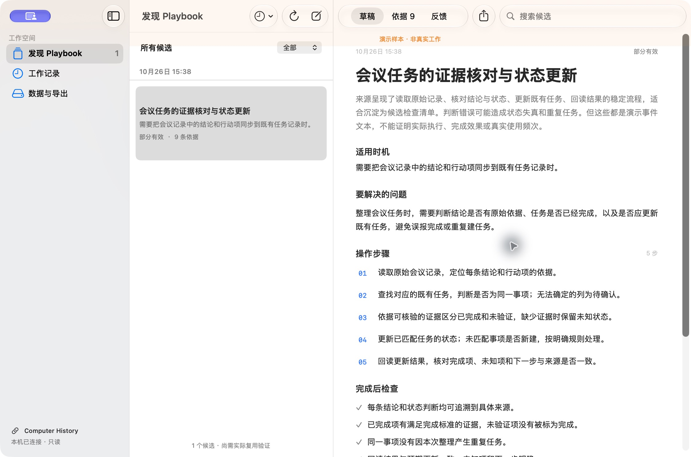

# Playbook 工作台

把工作记录变成可核对、可复用的方法。

A native macOS workbench that turns local Computer History records into evidence-backed playbook drafts.

读取 Computer History 已有的本地事件与摘要，利用 **Codex 的 ChatGPT 订阅登录**发现 Playbook 候选。每个候选保留来源依据，确认后可导出 Markdown，并在实际复用后记录反馈。



## 能做什么

- 浏览本地工作摘要与原始事件，搜索候选、查看依据和原文。
- 按时段导出原格式 JSONL、Markdown 与含 SHA256 的清单。
- 手动调用 Codex 分析，显示实际输入覆盖和缺失判断。
- 导出草稿、保存复用反馈；生成或导出不会自动标为有效。
- 原生 macOS 侧栏、列表和工具栏；新系统由系统框架提供 Liquid Glass 外观。

应用自身不录屏、不做 OCR、不增加监听器。输入来自已启用的 Computer History，或本应用已有的导出包。Computer History 的可用性、权限和文件格式取决于上游版本；这里的适配器使用本地文件，并非官方稳定 API。

## 候选阅读展示

0.2.6 支持可选的本机阅读稿：按「这次发生了什么、值得保留的方法、下次什么时候用、还需要补什么」组织概览，提供可展开的检查清单与来源说明。原始分析可完整回看，反馈仍绑定原候选；导出明确使用原始分析，不包含阅读稿改写。

阅读稿保存在应用数据目录的 `presentations.json`，需要按候选与来源准备。没有匹配阅读稿时显示原始候选，当前不会为后续新分析自动生成阅读稿。格式与启用方法见[开发说明](docs/DEVELOPMENT_HANDOFF.md#本机阅读样稿)和[合成配置示例](examples/reading-presentation.example.json)。个人阅读稿和真实截图不随源码分发。

## 构建与运行

需要 macOS 14+、Xcode 15+ 开发工具及 Python 3.9+。当前版本在 Apple Silicon、macOS 27.2、Xcode 27 上验证；旧系统仍需实机验证。

```sh
git clone https://github.com/kexu818/work-playbook-observer.git
cd work-playbook-observer
bash scripts/build-app.sh
open "dist/Playbook 工作台.app"
```

脚本使用 Apple 的 `actool` 编译 Logo 为应用图标，并进行本机 ad hoc 签名。这是源码构建流程，尚无公证安装包。

Fork 可通过 `PLAYBOOK_BUNDLE_ID` 指定应用标识。更新已有安装时应保留其原有标识，避免重新建立目录授权。

首次运行，在「数据与导出」选择含 `segments` 的 Computer History 根目录，或打开含 `manifest.json`、`events.jsonl` 的导出包。只请求对应目录访问，读取失败会在界面显示。

## Codex 订阅分析

先按 [Codex CLI 官方说明](https://developers.openai.com/codex/cli/)安装 CLI，再使用 ChatGPT 登录：

```sh
codex login
codex login status
```

点击工具栏的「发现新候选」后才开始一轮分析，会使用订阅额度。不会在失败后回退到 API Key 计费。

CLI 依次从 `PLAYBOOK_CODEX_BIN`、`PATH`、`~/.local/bin/codex`、`/opt/homebrew/bin/codex`、`/usr/local/bin/codex` 查找。可选环境变量 `PLAYBOOK_CODEX_RUNNER` 可指定兼容的隔离入口；已有 `~/.local/bin/ke-codex-verify` 时优先复用，否则使用随仓库提供的隔离运行器。

随附运行器需要 `~/.codex/auth.json` 中的 ChatGPT 文件登录，临时复制认证到独立 `CODEX_HOME`，不复制个人配置、全局规则、hooks、插件和外部 MCP 凭证，并禁用 shell 工具与网页搜索。完成、超时及可捕获终止信号后会清理临时认证；强制 SIGKILL 或系统崩溃无法保证即时清理。CLI 参数兼容性以所装版本为准，当前适配检查使用 Codex CLI 0.153.2。

## 数据边界

工作记录可能包含私人内容。点击分析时，有限长度的事件文本和摘要会交给 Codex 云端；应用没有敏感信息自动脱敏承诺。原始导出、输入包、结果和反馈保存在：

```text
~/Library/Application Support/work-playbook-observer/
```

这些副本与上游删除相互独立，保留至用户自行删除。公开仓库只包含代码、合成测试、Logo 和合成演示截图。详情见 [数据与隐私](docs/PRIVACY.md)。

## 开发

```sh
python3 -m unittest discover -s tests -v
python3 backend/history.py --help
swiftc Sources/PlaybookWorkbench/CandidatePresentation.swift tests/test_candidate_presentation.swift -o .build/test-candidate-presentation
.build/test-candidate-presentation
```

41 项测试覆盖只读快照、时间边界、损坏与部分行、路径越界、原格式导出、候选来源约束、反馈持久化、隔离认证清理和超时。隔离运行器使用 fake CLI 测试，不会在测试中调用真实模型或上传工作记录。

另有 8 项合成 Swift 检查，覆盖阅读稿与候选/来源绑定，以及保留试用历史的草稿状态展示。

- `Sources/PlaybookWorkbench/`：SwiftUI 应用。
- `backend/history.py`：本地文件适配、导出、候选与反馈。
- `backend/codex_runner.py`：可移植的 Codex 订阅隔离入口。
- `scripts/build-app.sh`：构建、图标编译及签名。
- [开发与验收](docs/DEVELOPMENT_HANDOFF.md)、[Logo 来源](assets/branding/README.md)。

## License

[MIT](LICENSE)。本项目为独立工具，与 Apple 或 OpenAI 没有官方隶属关系。
